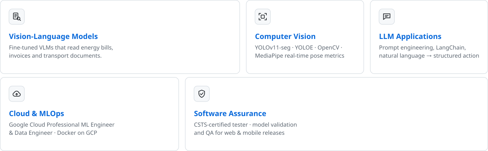
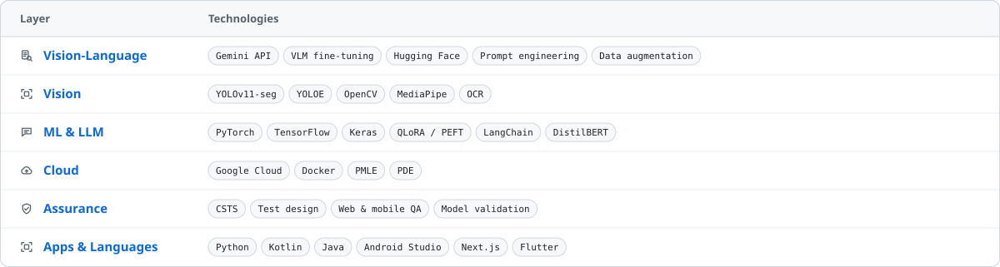
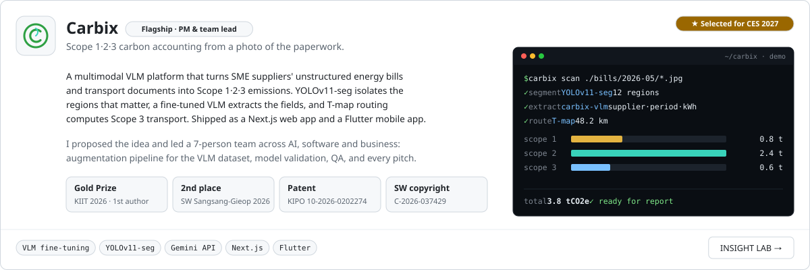
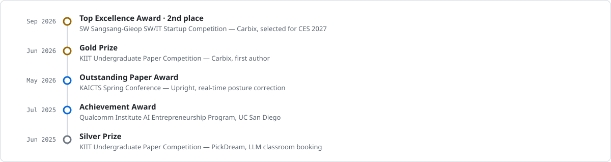
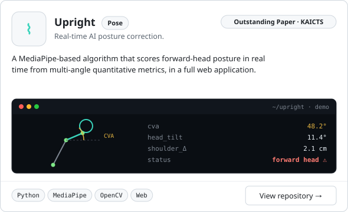
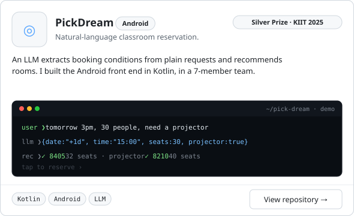
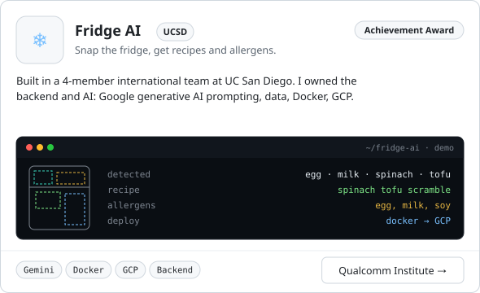
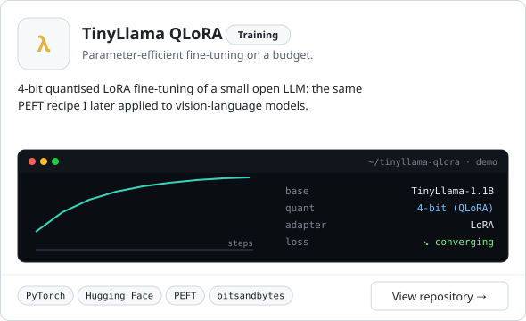

 

<a href="https://github.com/INSIGHT-LAB-Official">INSIGHT LAB</a> &nbsp;·&nbsp; <a href="https://github.com/INSIGHT-LAB-Official">Carbix</a> &nbsp;·&nbsp; <a href="https://github.com/chldus523/Upright-AI-Pose-Estimation">Upright</a> &nbsp;·&nbsp; <a href="mailto:digd6382@gmail.com">digd6382@gmail.com</a>

 

<code>❯ cd ~/about</code>

## About
AI · computer vision · vision-language models · cloud ML · software assurance

I'm an AI undergraduate at **Kyonggi University** (Division of AI Computer Science & Engineering, class of 2027) and project manager at **[INSIGHT LAB](https://github.com/INSIGHT-LAB-Official)**. I build vision-language systems that read messy real-world documents and turn them into numbers you can audit. My flagship is **Carbix**, a VLM platform that calculates Scope 1·2·3 carbon emissions from photos of energy bills and transport documents. It's heading to **CES 2027** in Las Vegas.

<picture>
  <source media="(prefers-color-scheme: dark)" srcset="./assets/about-dark.svg">
  
</picture>

  

<code>❯ cat ~/stack</code>

## Stack
From pixels to production.

<picture>
  <source media="(prefers-color-scheme: dark)" srcset="./assets/stack-dark.svg">
  
</picture>

  

<code>❯ cd ~/insight-lab/carbix</code>

## Flagship
What I led this year.

<a href="https://github.com/INSIGHT-LAB-Official">
<picture>
  <source media="(prefers-color-scheme: dark)" srcset="./assets/carbix-dark.svg">
  
</picture>
</a>

  

<code>❯ cd ~/recognition</code>

## Recognition
Awards and competitions.

<picture>
  <source media="(prefers-color-scheme: dark)" srcset="./assets/awards-dark.svg">
  
</picture>

  

<code>❯ ls ~/projects</code>

## Projects
Things I've built with teams, from research prototypes to deployed apps.

<a href="https://github.com/chldus523/Upright-AI-Pose-Estimation"><picture><source media="(prefers-color-scheme: dark)" srcset="./assets/proj-upright-dark.svg"></picture></a>
<a href="https://github.com/Dhuns/2025_Pick_Dream"><picture><source media="(prefers-color-scheme: dark)" srcset="./assets/proj-pickdream-dark.svg"></picture></a>

<a href="https://qi.ucsd.edu/"><picture><source media="(prefers-color-scheme: dark)" srcset="./assets/proj-fridge-dark.svg"></picture></a>
<a href="https://github.com/kyong-min/TinyLlama_QLoRA"><picture><source media="(prefers-color-scheme: dark)" srcset="./assets/proj-qlora-dark.svg"></picture></a>

**More from the lab bench:** [JAVA_GUI_IDE](https://github.com/kyong-min/JAVA_GUI_IDE) · [JAVA_TEXT_IDE](https://github.com/kyong-min/JAVA_TEXT_IDE) · [SIC-ASSEMBLER](https://github.com/kyong-min/SIC-ASSEMBLER) · [Distilbert-NLP-assignment](https://github.com/kyong-min/Distilbert-NLP-assignment) · [ES-101-term-project](https://github.com/kyong-min/ES-101-term-project)

 

<code>❯ cat ~/papers.bib</code>

## Papers
Conference papers (in Korean).

- **K. Kang**, S. Kim, S. Lee, D. Jeon, H. Jung, J. Lee. *Multimodal VLM Automated Scope 1·2·3 Carbon Accounting Platform.* KIIT Summer Conference, 2026. Oral. 🥇 Gold Prize
- J. Choi, **K. Kang**, J. Son, S. Lee. *A Study on a Real-Time AI Posture Correction System Using MediaPipe and Multi-Angle Quantitative Metrics.* KAICTS Spring Conference, 2026. 🏅 Outstanding Paper
- D. Jeon, **K. Kang**, S. Kim, H. Kim, H. Park, S. Cho, H. Jung, K. Kwon. *Natural Language-Based Classroom Reservation System with LLM.* KIIT Summer Conference, 2025. 🥈 Silver Prize

**IP:** Patent pending, KIPO 10-2026-0202274 (co-inventor) · Software copyright "Carbix", C-2026-037429

 

<code>❯ ls ~/certs</code>

## Certifications

 

<code>❯ exit</code> &nbsp;·&nbsp; Suwon, Republic of Korea &nbsp;·&nbsp; <a href="mailto:digd6382@gmail.com">digd6382@gmail.com</a>

